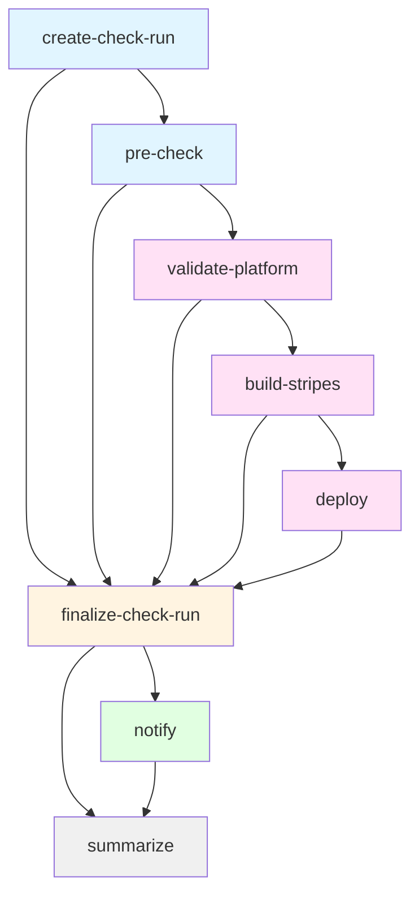

# Merge Queue Check Workflow

## Purpose

Validates a merge group of a platform release branch and reports the result as the check run
`eureka-ci/release-platform-validation`, the same context [Release PR Check](./release-pr-check.md) reports on the
pull request. The ruleset of the branch requires this one context, so GitHub merges the group when the check
succeeds and removes the pull request from the queue when it fails.

A branch whose configuration carries an enabled `deployment` block is also deployed: the configured Jenkins job
runs against the merge group ref, and its result is part of the same check. On `snapshot` this makes the nightly
environment deployment the gate for the update PR.

## Triggers

- **workflow_dispatch**: the only declared trigger.
- Automated in practice via the Eureka CI GitHub App webhook listener, which dispatches this workflow for
  `merge_group` `checks_requested` events on `folio-org/platform-lsp`. The mapping lives in
  `kitfox-github/gh-app-webhook-listener/terraform/environments/github_events_config.json`.

## Workflow Inputs

| Input | Type | Default | Required | Description |
|-------|------|---------|----------|-------------|
| `repo_owner` | string | - | Yes | Repository owner |
| `repo_name` | string | - | Yes | Repository name |
| `head_sha` | string | - | Yes | Head commit SHA of the merge group |
| `base_branch` | string | - | Yes | Target branch of the merge group |
| `head_branch` | string | `''` | No | Merge group ref without `refs/heads/`, e.g. `gh-readonly-queue/R1-2026/pr-123-<base sha>`; the pull request number is taken from it |

## Job Flow



## Jobs

### create-check-run
**Responsibility**: Create the check run `eureka-ci/release-platform-validation` on `head_sha` with status
`in_progress`, before any configuration is read.

**Outputs**:
- `check_run_id`: ID of the created check run
- `pr_number`: Pull request number parsed from `head_branch`, empty if it does not match

---

### pre-check
**Responsibility**: Read the update configuration and decide whether the target branch is validated through the
merge queue.

**Outputs**:
- `status`: `success`, `not_configured` or `misconfigured`
- `message`: Validation message
- `branch_entry`: The target branch's entry from `get-update-config` `branch_config`, as compact JSON
- `deployment_enabled`: `true` when the branch's `deployment.enabled` is `true`
- `deployment`: The branch's resolved `deployment` block, as compact JSON
- `deploy_job_timeout`: `deployment.timeout_minutes` plus 10, the `timeout-minutes` of the `deploy` job
- `step_total`: Number of steps reported in the check run (2, or 3 with a deployment)

**Not configured** (the check run concludes as `failure`):
- Configuration file (`.github/update-config.yml`) not found on `master`
- Updates disabled in configuration
- Target branch not listed under `branches`, or disabled
- Target branch has `need_pr` other than `true`

**Misconfigured** (deployment enabled; the check run concludes as `failure` before anything is validated):
- `deployment.jenkins_job` or `deployment.ref_parameter` is not set
- `deployment.timeout_minutes` plus 10 is not below `ruleset.merge_queue.check_response_timeout_minutes`
- No `head_branch` was passed, so there is no ref to deploy
- `vars.JENKINS_URL`, `secrets.JENKINS_USER` or `secrets.JENKINS_API_TOKEN` is not set

On `success` the job checks out `head_sha` and uploads `platform-descriptor.json` as the `platform-descriptor`
artifact.

**Composite Actions**:
- `folio-org/kitfox-github/.github/actions/get-update-config@master`

---

### validate-platform
**Responsibility**: Validate the platform descriptor and the dependencies of its applications against FAR.

**Runs**: When `pre-check` reports `success`

**Outputs**:
- `validation_passed`: `true` when validation passed
- `failure_reason`: Error message on failure

**Composite Actions**:
- `folio-org/platform-lsp/.github/actions/validate-platform@master`

---

### build-stripes
**Responsibility**: Install the UI dependencies of the merge group commit with Node 22 and the FOLIO npm registry
(`yarn install --frozen-lockfile` when `yarn.lock` exists). A `yarn.lock` that does not match `package.json`
fails the install.

**Runs**: When `validate-platform` passed

---

### deploy
**Responsibility**: Trigger the branch's `deployment.jenkins_job` with `deployment.ref_parameter` set to
`head_branch`, the immutable merge group ref, and wait for the build to finish.

**Runs**: When `build-stripes` succeeded and `deployment_enabled` is `true`

**Timeouts**: three layers, innermost first, so the check always reports a real conclusion:

| Layer | Value on `snapshot` | On expiry |
|-------|---------------------|-----------|
| `deployment.timeout_minutes` (polling loop) | 280 | The Jenkins build is stopped and the check concludes as `failure` |
| Job `timeout-minutes` (`timeout_minutes` + 10) | 290 | The job is cancelled and the check concludes as `failure` |
| `ruleset.merge_queue.check_response_timeout_minutes` | 300 | GitHub removes the entry from the queue |

`pre-check` rejects a configuration where the second layer is not below the third.

**Waiting**: the wait is synchronous. The job holds its runner for the whole build, and the check run stays
`in_progress` until `deploy` finishes, because `finalize-check-run` needs it.

**Dequeue during a deployment**: this workflow does not watch for the merge group being destroyed (a manual
dequeue, or the queue invalidating the entry). The build carries on and the environment ends up deployed from a
ref that will not merge. To take a pull request out of the queue while it deploys, cancel this run, then open
the Jenkins build linked by the `Jenkins build started` notice of the `Deploy via Jenkins` step and stop it if it
is still running. Cancellation asks the action to stop the build, but the runner may kill the step before that
request goes out.

**Outputs**:
- `result`: `success` or `failure`
- `build_url`: URL of the Jenkins build
- `jenkins_result`: Jenkins build result
- `failure_reason`: Why the deployment failed

**Composite Actions**:
- `folio-org/kitfox-github/.github/actions/trigger-jenkins-job@master`

---

### finalize-check-run
**Responsibility**: Complete the check run. Runs whenever the check run was created.

**Conclusion**:

| Outcome | Conclusion |
|---------|------------|
| Validation and Stripes build passed, no deployment configured | `success` |
| Validation, Stripes build and deployment passed | `success` |
| Target branch not configured | `failure` |
| Deployment misconfigured | `failure` |
| Configuration could not be read | `failure` |
| Validation failed | `failure` |
| Stripes build failed or did not complete | `failure` |
| Deployment failed, timed out or was cancelled | `failure` |
| Another job was cancelled | `cancelled` |

The check never concludes as `neutral` or `skipped`: GitHub treats both as passing a required check.

**Outputs**:
- `conclusion`: Conclusion of the check run
- `summary`: Summary of the check run

---

### notify
**Responsibility**: Send Slack notifications to configured channels.

**Runs**: Always, unless the run was cancelled

**Channels**:
- **Team Channel**: Repository variable `SLACK_NOTIF_CHANNEL` _(optional)_
- **General Channel**: Repository variable `GENERAL_SLACK_NOTIF_CHANNEL` _(optional)_

**Message Content**:
- Target branch, pull request and commit
- Jenkins build (if a deployment ran)
- Failure reason (if applicable)

**Required Secret**: `EUREKA_CI_SLACK_BOT_TOKEN`

---

### summarize
**Responsibility**: Generate workflow summary in GitHub Actions UI.

**Runs**: Always (regardless of previous job failures)

**Summary Sections**:
- Target branch, merge group, pull request and commit
- Check run conclusion
- Pre-check, platform validation and Stripes build status
- Deployment result and Jenkins build (if a deployment is configured)
- Notification status

## Configuration Requirements

### Repository File
**`.github/update-config.yml`** on `master`. The merge queue of a branch comes from its `ruleset` settings:

```yaml
update_config:
  enabled: true
  ruleset:
    enabled: true
    required_checks:
      - context: "eureka-ci/release-platform-validation"
    merge_queue:
      enabled: true

branches:
  - R1-2026:
      enabled: true
      need_pr: true
      ruleset:
        enabled: true
  - snapshot:
      enabled: true
      need_pr: true
      deployment:
        enabled: true
        jenkins_job: "folioScheduledProvisioning/createDailySnapshotEureka"
        ref_parameter: "PLATFORM_BRANCH"
        timeout_minutes: 280
      ruleset:
        enabled: true
        merge_queue:
          check_response_timeout_minutes: 300
          max_entries_to_build: 1
          max_entries_to_merge: 1
```

The `deployment` schema is documented in
[update-config.md](https://github.com/folio-org/kitfox-github/blob/master/.github/docs/update-config.md#deployment-configuration).

### Repository Variables
| Variable | Purpose | Required |
|----------|---------|----------|
| `EUREKA_CI_APP_ID` | Eureka CI GitHub App ID | Yes |
| `FAR_URL` | FAR API base URL | Yes |
| `JENKINS_URL` | Jenkins base URL | Only if a branch has a deployment |
| `SLACK_NOTIF_CHANNEL` | Team Slack channel ID | No |
| `GENERAL_SLACK_NOTIF_CHANNEL` | General Slack channel ID | No |

### Repository Secrets
| Secret | Purpose | Required |
|--------|---------|----------|
| `EUREKA_CI_APP_KEY` | Eureka CI GitHub App private key | Yes |
| `EUREKA_CI_SLACK_BOT_TOKEN` | Slack bot OAuth token | Only if notifications enabled |
| `JENKINS_USER` | Jenkins user of the API token | Only if a branch has a deployment |
| `JENKINS_API_TOKEN` | Jenkins API token, limited to building and reading the configured job | Only if a branch has a deployment |

## Permissions

```yaml
permissions:
  contents: read
```

Check runs are created and updated with an Eureka CI GitHub App installation token: the Checks API accepts only
GitHub App tokens, and the ruleset resolves the required check to that App. Everything else uses `GITHUB_TOKEN`.

## Usage Example

### Manual Trigger
```bash
gh workflow run merge-queue-check.yml \
  --repo folio-org/platform-lsp \
  -f repo_owner=folio-org \
  -f repo_name=platform-lsp \
  -f head_sha=abc123def456 \
  -f base_branch=R1-2026
```

A manual run reports the check run on `head_sha` like an automated one.

### Automated Trigger
The webhook listener dispatches the same workflow with the same inputs, plus `head_branch`, for every merge group.

## Related Documentation

- [Release PR Check](./release-pr-check.md) — reports the same check on the pull request
- [Post-Merge Flow](./post-merge-flow.md) — cleans up the update branch after the merge
- [Repository configuration](../update-config.yml) — this repository's `update-config.yml`
- [Branch Ruleset Automation](https://github.com/folio-org/kitfox-github/blob/master/.github/docs/branch-ruleset-automation.md) — provisions the rulesets and merge queues from that file
