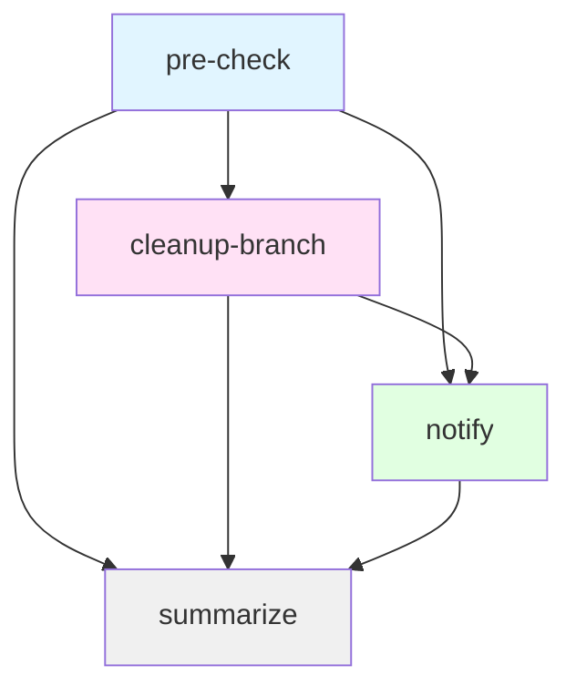

# Post-Merge Flow Workflow

## Purpose

Deletes the update branch of a merged platform update pull request. The workflow does not publish anything to FAR
and does not create a GitHub release.

## Triggers

- **workflow_dispatch**: the only declared trigger.
- Automated in practice via the Eureka CI GitHub App webhook listener, which dispatches this workflow for
  `pull_request` `closed` events on `folio-org/platform-lsp`. The mapping lives in
  `kitfox-github/gh-app-webhook-listener/terraform/environments/github_events_config.json`.

## Workflow Inputs

| Input | Type | Default | Required | Description |
|-------|------|---------|----------|-------------|
| `repo_owner` | string | - | Yes | Repository owner |
| `repo_name` | string | - | Yes | Repository name |
| `pr_number` | string | - | Yes | Pull request number |
| `head_sha` | string | - | Yes | Head commit SHA of the pull request |
| `base_branch` | string | `''` | No | Base branch the pull request was merged into; the base branch read from the pull request takes precedence |
| `merged` | string | `false` | No | `true` when the pull request was merged |

## Job Flow



## Jobs

### pre-check
**Responsibility**: Decide whether the closed pull request is a merged platform update pull request.

**Outputs**:
- `should_process`: `true` when the branch cleanup runs
- `skip_reason`: Why the pull request is skipped
- `base_branch`: Pull request base branch
- `head_branch`: Pull request head branch
- `pr_head_sha`: Current head commit of the pull request

**Skip Conditions** (the run completes as a success):
- The pull request was closed without merging
- Configuration file (`.github/update-config.yml`) not found on `master`
- Updates disabled in configuration
- Base branch not listed under `branches`
- Base branch has `need_pr` other than `true`
- Head branch is not the update branch of the base branch (`update_branch_format`, e.g. `version-update/R1-2026`
  for `R1-2026`)

**Composite Actions**:
- `folio-org/kitfox-github/.github/actions/get-pr-info@master`
- `folio-org/kitfox-github/.github/actions/get-update-config@master`

---

### cleanup-branch
**Responsibility**: Delete the merged update branch.

**Outputs**:
- `deleted`: `true`, `already_deleted`, `skipped` or `false`
- `failure_reason`: Error message on failure

**Logic**:
- The branch no longer exists: `already_deleted`, no failure
- The branch tip differs from the merged head commit: `skipped`, the branch is kept. The release update flow
  reuses the update branch, so a newer update pull request may already be on it.
- Otherwise the branch is deleted: `true`; a failed delete sets `false` and fails the job

---

### notify
**Responsibility**: Send Slack notifications to configured channels.

**Runs**: When the pull request was processed, or when `pre-check` failed

**Channels**:
- **Team Channel**: Repository variable `SLACK_NOTIF_CHANNEL` _(optional)_
- **General Channel**: Repository variable `GENERAL_SLACK_NOTIF_CHANNEL` _(optional)_

**Message Content**:
- Release branch and pull request
- Branch cleanup result
- Failure reason (if applicable)

**Required Secret**: `EUREKA_CI_SLACK_BOT_TOKEN`

---

### summarize
**Responsibility**: Generate workflow summary in GitHub Actions UI.

**Runs**: Always (regardless of previous job failures)

**Summary Sections**:
- Pull request and head commit
- Pre-check status or skip reason
- Branch cleanup result

## Configuration Requirements

### Repository File
**`.github/update-config.yml`** on `master`, the same file `release-scan.yml` and `release-pr-check.yml` read:

```yaml
update_config:
  enabled: true
  update_branch_format: version-update/{0}

branches:
  - snapshot:
      enabled: true
      need_pr: false
  - R1-2026:
      enabled: true
      need_pr: true
```

Only branches with `need_pr: true` get update pull requests, so only their update branches are cleaned up.

### Repository Variables
| Variable | Purpose | Required |
|----------|---------|----------|
| `SLACK_NOTIF_CHANNEL` | Team Slack channel ID | No |
| `GENERAL_SLACK_NOTIF_CHANNEL` | General Slack channel ID | No |

### Repository Secrets
| Secret | Purpose | Required |
|--------|---------|----------|
| `EUREKA_CI_SLACK_BOT_TOKEN` | Slack bot OAuth token | Only if notifications enabled |

## Permissions

```yaml
permissions:
  contents: write
  pull-requests: read
```

All GitHub calls use `GITHUB_TOKEN`; `contents: write` covers the branch deletion.

## Usage Example

### Manual Trigger
```bash
gh workflow run post-merge-flow.yml \
  --repo folio-org/platform-lsp \
  -f repo_owner=folio-org \
  -f repo_name=platform-lsp \
  -f pr_number=123 \
  -f head_sha=abc123def456 \
  -f merged=true
```

### Automated Trigger
The webhook listener dispatches the same workflow with the same inputs, plus `base_branch`, when a pull request is
closed. Re-running a run is safe: a deleted branch is reported as `already_deleted`.

## Related Documentation

- [Release Update Flow](./release-update-flow.md) — creates and updates the update branch and its pull request
- [Release PR Check](./release-pr-check.md) — validates the update pull request before the merge
- [Repository configuration](../update-config.yml) — this repository's `update-config.yml`
- [Update Configuration Schema](https://github.com/folio-org/kitfox-github/blob/master/.github/docs/update-config.md) — the schema that file follows
